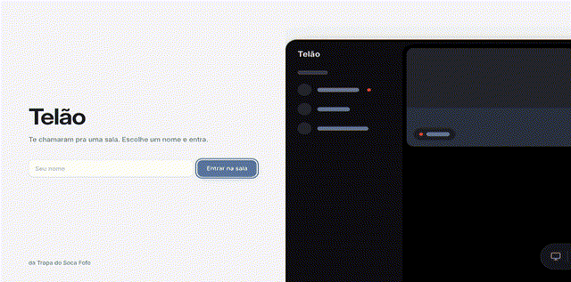
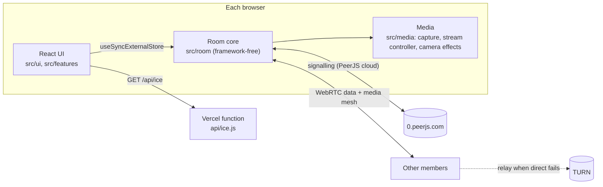

# Telão

Peer-to-peer screen sharing for a Discord friend group. Someone opens a room, drops the link in Discord, and up to eight people watch each other's games, with up to four screens live at once. Cameras, room-wide meme sounds, reactions and tomatoes thrown at whoever is live. No accounts, no media server.

Live at **https://telao-snowy.vercel.app**. The UI is in Portuguese (Brazil).



## Features

- **Rooms by link.** `/sala/<code>`; the old `/#<code>` links redirect.
- **Screen sharing.** Quality profiles: games 720p60, text 1080p30, light 720p30. H.264 is preferred, and an adaptive controller reacts to CPU and bandwidth pressure using WebRTC stats.
- **Discord voice never leaks.** Only a shared browser tab sends audio. Capture excludes system audio and drops audio from whole-screen surfaces. A unit test locks these options.
- **Cameras.** Effects (mono, VHS, neon, pixel) run on a canvas only while one is selected.
- **Stage.** Resizable grid or focus layout, theater and fullscreen. A Discord-style preview of your own screen, hidden by default. Small tiles ask the sender for thumbnail quality.
- **Per-tile audio.** Every tile starts muted; each viewer picks whose sound they hear.
- **Zoeira.**
  - [myinstants](https://www.myinstants.com) meme sounds played for the whole room, with custom memes and hotkeys.
  - Emoji reactions.
  - Tomatoes, eggs and slippers thrown at a live screen.
  - Away mode turns all of it off for one viewer.
- **Diagnostics.** An overlay shows codec, hardware encoding, fps, bitrate and the quality-limitation reason.

## Architecture



- **Hub election.** The first member claims the peer id `telao-<code>` and acts as the directory. If it leaves, another member takes over. A network blip keeps the hub, and only an `unavailable-id` error makes it step down.
- **Mesh.** Members connect to each other directly. Every data-channel message is a zod discriminated union, validated at the boundary (`src/room/protocol.ts`).
- **Media.** Media calls retry after a drop. ICE gets a 15-second grace period before a peer counts as gone.
- **TURN.** Credentials live in Vercel environment variables. Browsers receive them only through `/api/ice`, so they are never in the repo.

## Stack

Vite, React 19, TypeScript, TanStack Router, shadcn/ui on Base UI, Tailwind, PeerJS, zod. Vitest for unit and fake-network room tests, Playwright with Chrome's fake media for multi-person end-to-end tests.

## Run it

```sh
cd web
npm install
npm run dev          # http://localhost:5173
npm test             # Vitest
npm run test:e2e     # Playwright, needs Google Chrome and network access to 0.peerjs.com
npm run build
```

Under `vite dev` there is no `/api/ice`, so rooms fall back to STUN. That connects on most networks.

## Deploy

Run `vercel deploy --prod` from the repository root. `vercel.json` builds `web/` and serves `web/dist` with an SPA fallback, and deploys `api/` as functions. TURN needs these environment variables on the Vercel project:

- `TURN_URLS`, comma-separated;
- `TURN_USERNAME`;
- `TURN_CREDENTIAL`.

## Repository

- `web/`: the app.
- `api/ice.js`: ICE server endpoint.
- `docs/`: `design.md` (visual spec), `rewrite-plan.md`, `demo.gif`.
- `public/`, `tests/`: the original single-file version and its tests. They are kept for rollback until the new app has run in production for a while.

To record the demo again:

```sh
cd web
DEMO=1 npx playwright test -c playwright.demo.config.ts
```

Then turn `e2e/demo/frames.ffconcat` into a GIF with ffmpeg.
